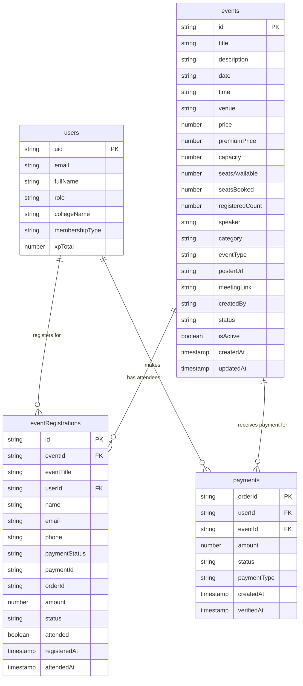
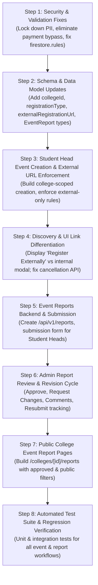

# ANX CLUB — EVENT MODULE AUDIT & GAP ANALYSIS REPORT
**Assigned Responsibility:** Events, Registrations and Event Reports (Nandhitha)  
**Audit Date:** 2026-10-29  
**Auditor:** Senior Full-Stack Engineer & Code Auditor  
**Audit Scope:** Events Lifecycle, Event Discovery, Registration Flows (Internal & External), Event Reports Workflow, Firestore Schema & Rules, Security Boundaries, Test Coverage, and Cross-Teammate Integration.

---

## 1. Executive Summary

This comprehensive code audit evaluates the current state of the **Events, Registrations, and Event Reports** module within the ANX Club platform repository. The audit was conducted strictly against the actual codebase located in the repository, tracing all flows through UI components, API route handlers, authentication/authorization layers, Firestore security rules, client/server data persistence, and test infrastructure.

### Key High-Level Findings:

1. **Event Management (Admin vs. Student Head):**
   - **Admin Event Management is Partially Implemented:** Admins can view events on `/admin/events`, create events on `/admin/events/create`, soft-delete events via `DELETE /api/v1/events/[id]`, and inspect registrations in a modal. However, **editing existing events, publishing/unpublishing toggles, formal cancellation lifecycle states, registration deadline inputs, and college attribution are completely missing**.
   - **Student Head Event Management is 100% Missing:** There is **no Student Head role handling, no college-scoped event creation UI, no backend college permission verification, and no external registration link support**. Any authenticated user (or unauthenticated client hitting mock/fallback tokens) can trigger event creation APIs without college association.

2. **Registrations (Internal vs. External):**
   - **Critical Architecture Conflict & Security Bypass:** The platform has two conflicting registration endpoints: `/api/events/register` and `/api/v1/events/[id]/register`. Both suffer from severe security vulnerabilities:
     - `/api/events/register` performs **no authentication**, accepts arbitrary `userId` from the request body, and contains a logical flaw (`eventData.price > 0 && eventData.premiumPrice > 0`) that allows paid events with free/undefined premium prices to register as free.
     - `/api/v1/events/[id]/register` falls back to `body.userId` or `'default_user_123'` when unauthenticated, and **allows direct creation of "paid" registrations with arbitrary client-supplied `paymentId`/`orderId` without verifying Razorpay signatures or checking payment records**.
     - On the frontend, `PaidEventCheckoutModal.tsx` calls `handleSimulatedPayment()` if `NEXT_PUBLIC_RAZORPAY_KEY_ID` is omitted, bypassing payment entirely. When Razorpay is active, it calls the payment verification endpoint and *then* additionally calls `POST /api/v1/events/[id]/register`, creating duplicate registrations and double seat increments.
   - **Student Head External Registration Enforcement is 100% Missing:** Student Head events must strictly use external registration URLs (e.g., Google Forms), cannot record internal registrations, and must never process payments. Currently, all event cards and detail pages render internal registration buttons that post directly to internal registration endpoints.
   - **Client-Side Fake Cancellation:** In `src/app/(dashboard)/events/page.tsx` and `src/app/(dashboard)/events/[id]/page.tsx`, clicking "Cancel Registration" merely mutates local React state (`registeredList.filter(...)`) and displays a success toast. **It never issues an API call to the backend or Firestore**, leaving the database registration intact.

3. **Event Reports Workflow (100% Missing):**
   - The required end-to-end lifecycle—Student Head report submission, event/college linkage, Admin review/approval/rejection/revision-request, revision history tracking, and public college-wise display—**does not exist anywhere in the codebase**. There are no schemas, no Firestore collections, no API endpoints, no Admin review dashboards, and no public college report routes.

4. **Security & Data Integrity Vulnerabilities:**
   - Public exposure of attendee PII: `GET /api/v1/admin/events/[id]/registrations` contains **zero authentication or role checks**, allowing anyone on the internet to dump attendee names, emails, phones, and payment statuses.
   - Insecure Firestore Security Rules: `/events/{eventId}` allows unrestricted public reads (`allow read: if true`), exposing draft, cancelled, and unpublished events. `/eventRegistrations/{registrationId}` allows any authenticated user to write documents (`allow create: if isAuthenticated`), bypassing backend validation, capacity limits, and external-only rules.
   - Silent In-Memory Fallbacks: When Firestore operations fail or throw errors, multiple endpoints (`/api/v1/events`, `/api/v1/events/[id]/register`) log warnings and fall back to `src/lib/memory-store.ts`, returning HTTP 200/201 success to the client despite database failure.

5. **Test Coverage:**
   - 4 test suites pass in the repository (`admin-auth.test.ts`, `admin-users.test.ts`, `gamification.test.ts`, `razorpay-signature.test.ts`), but **0 tests exist for events, registrations, or event reports**.

---

## 2. Repository and Architecture Overview

### Technology Stack & Dependencies
- **Framework:** Next.js `14.2.35` (React `18.2.0`, Node.js App Router with `'force-dynamic'` API route handlers).
- **Language & Runtime:** TypeScript `5.x`, TSX `4.23.12`.
- **Package Manager:** `npm` (verified by `package-lock.json` in project root).
- **Styling & UI:** TailwindCSS `3.4.19`, PostCSS, Framer Motion `12.42.2`, Lucide React `1.26.0`, Radix UI primitives.
- **Database & Authentication:**
  - Client SDK: `firebase` `12.14.0`.
  - Server SDK: `firebase-admin` `13.10.0` (Firestore, Auth, Storage).
  - Client auth helper: `jose` `6.2.9` (JWT decode).
- **Payment Processing:** `razorpay` `2.9.6` (Node SDK) and client checkout script.
- **Email & Communications:** `resend` (REST email dispatch), Fast2SMS (SMS OTP).
- **Validation:** `zod` `4.4.3` (partial use in `/api/events/register`).
- **Testing:** `jest` `30.4.2`, `@testing-library/react` `16.3.2`, `jest-environment-jsdom` `30.4.1`.

### Directory & Route Architecture
```
ANX-CLUB-main/ANX-CLUB-main/
├── __tests__/                      # Jest unit & integration tests (No event tests)
├── firestore.rules                 # Cloud Firestore security rules
├── firestore.indexes.json          # Firestore composite indexes
├── package.json                    # Project configuration & dependencies
├── src/
│   ├── app/
│   │   ├── (admin)/
│   │   │   ├── admin/
│   │   │   │   ├── events/
│   │   │   │   │   ├── page.tsx            # Admin Event Listing & Registrations modal
│   │   │   │   │   └── create/page.tsx     # Admin Event Creation Form
│   │   │   │   ├── submissions/page.tsx    # Admin review (Resumes, Mentors, Incubator only)
│   │   │   │   └── page.tsx                # Admin Dashboard KPI & Controls
│   │   │   └── layout.tsx
│   │   ├── (dashboard)/
│   │   │   ├── dashboard/page.tsx          # Member Home (Upcoming & Registered Event feeds)
│   │   │   ├── events/
│   │   │   │   ├── page.tsx                # Student Event Discovery Catalog
│   │   │   │   └── [id]/page.tsx           # Event Detail & Registration page
│   │   │   └── layout.tsx
│   │   ├── api/
│   │   │   ├── admin/events/route.ts       # Unauthenticated legacy admin events API
│   │   │   ├── events/
│   │   │   │   ├── route.ts                # Unauthenticated legacy events API
│   │   │   │   ├── register/route.ts       # Unauthenticated free registration API
│   │   │   │   └── [id]/check-in/route.ts  # Attendance QR check-in & +50 XP award
│   │   │   └── v1/
│   │   │       ├── admin/
│   │   │       │   ├── events/
│   │   │       │   │   ├── route.ts        # Admin GET/POST events (Admin auth checked)
│   │   │       │   │   └── [id]/
│   │   │       │   │       ├── approve/route.ts       # Admin Approve/Reject PATCH
│   │   │       │   │       └── registrations/route.ts # UNPROTECTED event registrations GET
│   │   │       ├── events/
│   │   │       │   ├── route.ts            # Public GET & Insecure POST events API
│   │   │       │   └── [id]/
│   │   │       │       ├── route.ts        # GET event, Admin PUT update, Admin DELETE
│   │   │       │       ├── register/route.ts          # Flawed registration & payment bypass
│   │   │       │       └── registrations/route.ts     # Admin GET registrations with CSV export
│   │   │       └── payments/
│   │   │           └── verify/route.ts     # Razorpay signature & atomic seat reservation
│   ├── components/
│   │   ├── EventCard.tsx                   # Standalone Event Card component
│   │   ├── EventListRow.tsx                # Standalone Event Table Row component
│   │   ├── RegisterModal.tsx               # Modal for internal event registration
│   │   └── events/
│   │       └── PaidEventCheckoutModal.tsx  # Modal for paid event checkout
│   ├── lib/
│   │   ├── auth.ts                         # Token extractor & mock token bypass
│   │   ├── auth-helpers.ts                 # Client token getter
│   │   ├── constants.ts                    # MOCK_EVENTS, MOCK_USER, categories
│   │   ├── memory-store.ts                 # Global memory cache fallback
│   │   ├── firebase/
│   │   │   ├── admin.ts                    # Firebase Admin SDK initialization
│   │   │   ├── admin-auth.ts               # Token verification & role extraction
│   │   │   └── client.ts                   # Firebase Client SDK initialization
│   │   └── payments/
│   │       └── razorpay.ts                 # Razorpay signature verification utility
│   ├── middleware.ts                       # Next.js edge route middleware (JWT decode)
│   └── types/
│       └── index.ts                        # Global TypeScript interfaces
```

---

## 3. Event-Related File Inventory

| File Path | Responsibility / Purpose | Line References | Status / Quality Note |
|:---|:---|:---|:---|
| [`firestore.rules`](file:///C:/Users/NANDHITHA%20RATAN/OneDrive/Documents/internship%20anx/ANX-CLUB-main/ANX-CLUB-main/firestore.rules) | Cloud Firestore security rules | L38–L53 | **Vulnerable**: Unrestricted event reads; unrestricted client registration creation; `eventReports` missing. |
| [`src/types/index.ts`](file:///C:/Users/NANDHITHA%20RATAN/OneDrive/Documents/internship%20anx/ANX-CLUB-main/ANX-CLUB-main/src/types/index.ts) | TypeScript definitions for `User`, `Event`, `Mentor`, `Project` | L20–L49 | **Incomplete**: `Event` missing college, creator role, external URL, lifecycle state; `EventRegistration` & `EventReport` missing. |
| [`src/middleware.ts`](file:///C:/Users/NANDHITHA%20RATAN/OneDrive/Documents/internship%20anx/ANX-CLUB-main/ANX-CLUB-main/src/middleware.ts) | Edge route middleware for auth tokens | L9–L79 | **Insecure**: Unverified JWT decoding; exempts all event GET requests; accepts mock tokens. |
| [`src/lib/auth.ts`](file:///C:/Users/NANDHITHA%20RATAN/OneDrive/Documents/internship%20anx/ANX-CLUB-main/ANX-CLUB-main/src/lib/auth.ts) | Server-side bearer token authentication helper | L26–L43 | **Insecure**: Hardcoded bypass for mock tokens (`mock_`, `admin_`, `usr_`). |
| [`src/lib/firebase/admin-auth.ts`](file:///C:/Users/NANDHITHA%20RATAN/OneDrive/Documents/internship%20anx/ANX-CLUB-main/ANX-CLUB-main/src/lib/firebase/admin-auth.ts) | Verifies Firebase ID token & extracts user role | L34–L51, L118–L121 | **Insecure**: Mock tokens grant instant Admin role; does not return `collegeId`. |
| [`src/lib/memory-store.ts`](file:///C:/Users/NANDHITHA%20RATAN/OneDrive/Documents/internship%20anx/ANX-CLUB-main/ANX-CLUB-main/src/lib/memory-store.ts) | In-memory singleton fallback store | L5–L35, L212–L240, L326–L338 | **Masks DB Failures**: Active mock fallback prevents errors from surfacing when Firestore operations fail. |
| [`src/app/api/events/route.ts`](file:///C:/Users/NANDHITHA%20RATAN/OneDrive/Documents/internship%20anx/ANX-CLUB-main/ANX-CLUB-main/src/app/api/events/route.ts) | Legacy public events endpoint | L6–L58 | **Critical Security Flaw**: POST has zero authentication or validation; auto-approves events. |
| [`src/app/api/v1/events/route.ts`](file:///C:/Users/NANDHITHA%20RATAN/OneDrive/Documents/internship%20anx/ANX-CLUB-main/ANX-CLUB-main/src/app/api/v1/events/route.ts) | Consolidated events list and creation endpoint | L10–L98 (GET), L100–L211 (POST) | **Flawed Auth & Fallbacks**: POST defaults unauthenticated users to admin; merges memory store; no college filter. |
| [`src/app/api/v1/events/[id]/route.ts`](file:///C:/Users/NANDHITHA%20RATAN/OneDrive/Documents/internship%20anx/ANX-CLUB-main/ANX-CLUB-main/src/app/api/v1/events/[id]/route.ts) | Single event GET, Admin PUT, Admin DELETE | L10–L61 (GET), L63–L93 (PUT), L95–L122 (DELETE) | **Partial**: GET exposes inactive/draft events; PUT only permits Admin; soft delete only. |
| [`src/app/api/admin/events/route.ts`](file:///C:/Users/NANDHITHA%20RATAN/OneDrive/Documents/internship%20anx/ANX-CLUB-main/ANX-CLUB-main/src/app/api/admin/events/route.ts) | Legacy admin events endpoint | L6–L54 | **Critical Security Flaw**: Zero auth on GET and POST. |
| [`src/app/api/v1/admin/events/route.ts`](file:///C:/Users/NANDHITHA%20RATAN/OneDrive/Documents/internship%20anx/ANX-CLUB-main/ANX-CLUB-main/src/app/api/v1/admin/events/route.ts) | Admin events listing & creation endpoint | L7–L57 (GET), L59–L108 (POST) | **Partial**: Enforces admin check, but lacks PUT/PATCH/DELETE endpoints. |
| [`src/app/api/v1/admin/events/[id]/approve/route.ts`](file:///C:/Users/NANDHITHA%20RATAN/OneDrive/Documents/internship%20anx/ANX-CLUB-main/ANX-CLUB-main/src/app/api/v1/admin/events/[id]/approve/route.ts) | Admin Approve/Reject PATCH handler | L5–L40 | **Limited**: Only changes status between `Approved` and `Rejected`. |
| [`src/app/api/events/register/route.ts`](file:///C:/Users/NANDHITHA%20RATAN/OneDrive/Documents/internship%20anx/ANX-CLUB-main/ANX-CLUB-main/src/app/api/events/register/route.ts) | Legacy event registration endpoint | L18–L111 | **Critical Flaw**: No auth; trusts body `userId`; faulty price check (`L43`). |
| [`src/app/api/v1/events/[id]/register/route.ts`](file:///C:/Users/NANDHITHA%20RATAN/OneDrive/Documents/internship%20anx/ANX-CLUB-main/ANX-CLUB-main/src/app/api/v1/events/[id]/register/route.ts) | Main event registration endpoint | L8–L239 | **Critical Security Bypass**: Unauthenticated fallback; allows registering paid events as "paid" without payment verification; silent failure. |
| [`src/app/api/v1/admin/events/[id]/registrations/route.ts`](file:///C:/Users/NANDHITHA%20RATAN/OneDrive/Documents/internship%20anx/ANX-CLUB-main/ANX-CLUB-main/src/app/api/v1/admin/events/[id]/registrations/route.ts) | Registration attendee list endpoint | L7–L43 | **Critical Privacy Violation**: Publicly accessible without any auth; dumps attendee PII. |
| [`src/app/api/v1/events/[id]/registrations/route.ts`](file:///C:/Users/NANDHITHA%20RATAN/OneDrive/Documents/internship%20anx/ANX-CLUB-main/ANX-CLUB-main/src/app/api/v1/events/[id]/registrations/route.ts) | Admin event registrations with CSV export | L7–L72 | **Working**: Proper admin check and CSV streaming. |
| [`src/app/api/events/[id]/check-in/route.ts`](file:///C:/Users/NANDHITHA%20RATAN/OneDrive/Documents/internship%20anx/ANX-CLUB-main/ANX-CLUB-main/src/app/api/events/[id]/check-in/route.ts) | Live event attendance check-in & XP | L8–L104 | **Working**: Checks registration and awards +50 XP. |
| [`src/app/(admin)/admin/events/page.tsx`](file:///C:/Users/NANDHITHA%20RATAN/OneDrive/Documents/internship%20anx/ANX-CLUB-main/ANX-CLUB-main/src/app/(admin)/admin/events/page.tsx) | Admin Event Management Dashboard UI | L1–L307 | **Partial**: Fetches public route; delete works; lacks edit, publish toggle, cancel, and college filtering. |
| [`src/app/(admin)/admin/events/create/page.tsx`](file:///C:/Users/NANDHITHA%20RATAN/OneDrive/Documents/internship%20anx/ANX-CLUB-main/ANX-CLUB-main/src/app/(admin)/admin/events/create/page.tsx) | Admin Event Creation UI | L1–L343 | **Partial**: Hardcoded mock admin token fallback; lacks college, registration type, external URL, and draft status. |
| [`src/app/(dashboard)/events/page.tsx`](file:///C:/Users/NANDHITHA%20RATAN/OneDrive/Documents/internship%20anx/ANX-CLUB-main/ANX-CLUB-main/src/app/(dashboard)/events/page.tsx) | Student Event Discovery Catalog UI | L1–L461 | **Partial / Flawed**: No college filter; no external link support; client-side fake cancellation (`L251–L256`). |
| [`src/app/(dashboard)/events/[id]/page.tsx`](file:///C:/Users/NANDHITHA%20RATAN/OneDrive/Documents/internship%20anx/ANX-CLUB-main/ANX-CLUB-main/src/app/(dashboard)/events/[id]/page.tsx) | Single Event Details & Registration UI | L1–L384 | **Partial / Flawed**: No college badge; no external registration button; client-side fake cancellation (`L105–L109`). |
| [`src/components/events/PaidEventCheckoutModal.tsx`](file:///C:/Users/NANDHITHA%20RATAN/OneDrive/Documents/internship%20anx/ANX-CLUB-main/ANX-CLUB-main/src/components/events/PaidEventCheckoutModal.tsx) | Paid Event Checkout & Razorpay modal | L1–L255 | **Critical Conflict**: Simulates payment when key missing; double-registers on real payment (`L107–L110`). |
| [`src/app/api/v1/payments/verify/route.ts`](file:///C:/Users/NANDHITHA%20RATAN/OneDrive/Documents/internship%20anx/ANX-CLUB-main/ANX-CLUB-main/src/app/api/v1/payments/verify/route.ts) | Payment verification & seat booking transaction | L103–L215 | **Working but bypassed**: Verifies signature and creates registration, but frontend doubles the registration. |

---

## 4. Existing Feature Matrix

| Feature | Status | Evidence (Path & Lines) | Observed Behavior | Gap or Risk |
|:---|:---:|:---|:---|:---|
| **Admin Event Creation** | **Partial** | `src/app/(admin)/admin/events/create/page.tsx#L55-L75`, `src/app/api/v1/events/route.ts#L100-L211` | Admin can submit title, date, time, venue, speaker, capacity, and price. Status defaults to `'Approved'`. | Missing college assignment, registration type, external URL, draft/publish states, registration deadline, and image uploads. Uses mock token fallback. |
| **Admin Event Editing** | **Missing** | `src/app/(admin)/admin/events/page.tsx#L214-L240`, `src/app/api/v1/admin/events/route.ts` | No "Edit Event" button or form page exists in the admin dashboard. While `PUT /api/v1/events/[id]` exists, no UI connects to it. | Admin cannot update event dates, venues, capacities, speakers, or links after creation. |
| **Admin Event Publication Control** | **Missing** | `src/app/api/v1/events/route.ts#L182`, `src/app/api/v1/admin/events/[id]/approve/route.ts#L27-L33` | Events are hardcoded to `status: "Approved"` upon creation. Admin can only toggle `'Approved'` or `'Rejected'` via an API route that has no UI button. | No publish, unpublish, republish, or schedule controls exist. |
| **Admin Event Cancellation** | **Missing** | `src/app/(admin)/admin/events/page.tsx#L53-L75` | Only "Delete Event" exists, which calls `DELETE /api/v1/events/[id]` setting `isActive: false`. | No cancel state (`status: 'cancelled'`), no cancellation reason, and no attendee cancellation notifications. |
| **Student Head Event Creation** | **Missing** | `src/app/` (Search across all routes) | No UI page, form, or API route exists for Student Heads to create events for their college. | Student Heads cannot create events; entire PRD requirement is unbuilt. |
| **Student Head College Isolation** | **Missing** | `src/lib/firebase/admin-auth.ts#L117-L121`, `firestore.rules#L38-L41` | User token verification does not resolve `collegeId`. Firestore rules only check `isAdmin()`. | If a Student Head gets write access, nothing prevents cross-college event modification. |
| **External Registration URL Handling** | **Missing** | `src/types/index.ts#L20-L49`, `src/app/(dashboard)/events/page.tsx#L147-L168` | `Event` interface lacks `externalRegistrationUrl`. UI cards and detail pages only show internal "Register" button. | Student Head events cannot link to Google Forms; students are forced into internal registration. |
| **External Registration Safeguard** | **Missing** | `src/app/api/v1/events/[id]/register/route.ts#L83-L135` | The backend registration endpoint accepts registrations for ANY event ID without checking if it was created by a Student Head. | Violates the core rule: ANX Club must not create internal registrations or attendee counts for Student Head events. |
| **Internal Free Registration** | **Partial** | `src/app/api/v1/events/[id]/register/route.ts#L83-L138`, `src/components/RegisterModal.tsx#L53-L76` | Authenticated users can register for free events; registration is recorded in Firestore transaction. | Endpoint accepts unauthenticated fallbacks (`default_user_123`); transaction failures silently fall back to memory store. |
| **Internal Paid Registration (Razorpay)** | **Partial / Broken** | `src/components/events/PaidEventCheckoutModal.tsx#L42-L114`, `src/app/api/v1/events/[id]/register/route.ts#L75-L100` | UI provides a payment modal, but if key is missing, it simulates payment. If Razorpay is used, it calls verify AND register, doubling registrations. | Direct call to `/api/v1/events/[id]/register` allows registering for paid events without payment verification. |
| **Duplicate Registration Prevention** | **Partial** | `src/app/api/v1/events/[id]/register/route.ts#L51-L64, L131` | Endpoint checks for existing registration doc before transaction, but transaction generates a random doc ID (`.doc()`). | Concurrent race conditions allow duplicate registrations. Catch block ignores query errors. |
| **Event Registration Cancellation** | **Broken** | `src/app/(dashboard)/events/page.tsx#L251-L256`, `src/app/(dashboard)/events/[id]/page.tsx#L105-L109` | Clicking "Cancel Registration" only mutates React state (`setRegisteredList`) and shows toast. | **Zero backend API calls**. Registration doc remains in Firestore; capacity/seats are never refunded. |
| **Event Discovery & Search** | **Partial** | `src/app/(dashboard)/events/page.tsx#L294-L312` | Search filters by title, description, and speaker in memory. Categories (Workshop, Webinar, Hackathon, Networking) work. | **No college filter**. No date-range filter. Search is client-side only. |
| **Unpublished / Cancelled Event Protection** | **Missing** | `src/app/api/v1/events/route.ts#L28`, `firestore.rules#L38-L41` | Endpoint only filters `isActive !== false`. Firestore security rule allows `read: if true` for all docs in `/events`. | Draft, unpublished, or cancelled events are completely visible to students and public clients. |
| **Event Reports Submission** | **Missing** | Entire codebase | No form, endpoint, or Firestore collection exists for Student Heads to submit post-event reports. | Feature 100% missing. |
| **Event Reports Review & Approval** | **Missing** | `src/app/(admin)/admin/submissions/page.tsx#L16` | Admin submissions page only has tabs for Resumes, Mentors, and Incubator. | Admins cannot review, approve, reject, or request changes on event reports. |
| **Report Status & Revision History** | **Missing** | Entire codebase | No data model or tracking for report lifecycle states (`draft`, `submitted`, `under_review`, `revision_requested`, `approved`, `rejected`). | Feature 100% missing. |
| **Public College-wise Event Reports** | **Missing** | `src/app/` (Search across all routes) | No public routes exist (e.g. `/colleges/[id]/reports` or `/reports/[id]`). | Public cannot view college activities; approved reports cannot be displayed. |
| **Attendee PII Security** | **Vulnerable** | `src/app/api/v1/admin/events/[id]/registrations/route.ts#L7-L43` | Endpoint returns attendee names, emails, phones, amounts, and payment IDs without authentication. | Critical data leak: Any unauthenticated caller can scrape member contact information. |

---

## 5. Firestore Data Flow

### Collections Actually Found in Codebase



### Observed Field Discrepancies & Gaps

1. **`events` Collection:**
   - **Fields present:** `id`, `title`, `description`, `date`, `time`, `venue`, `price`, `premiumPrice`, `capacity`, `seats`, `seatsAvailable`, `seatsBooked`, `registeredCount`, `speaker`, `speakerName`, `speakerBio`, `speakerImage`, `category`, `eventType`, `memberOnly`, `premiumOnly`, `posterUrl`, `onlineLink`, `meetingLink`, `isOnline`, `isActive`, `status`, `createdBy`, `createdAt`, `updatedAt`.
   - **Critically missing fields:**
     - `collegeId` / `collegeName`: Required for Student Head ownership and college-specific event scoping.
     - `createdByRole`: To distinguish Admin events from Student Head events.
     - `registrationType`: Must be explicitly set to `'internal'` (Admin only) or `'external'` (Student Head).
     - `externalRegistrationUrl`: Required for Student Head events (e.g., Google Form URL).
     - `publicationStatus`: `'draft'` | `'published'` | `'archived'` (currently only `status: 'Approved'` is used).
     - `lifecycleStatus`: `'upcoming'` | `'live'` | `'completed'` | `'cancelled'`.
     - `cancellationReason`: Required when an event is cancelled.

2. **`eventRegistrations` Collection:**
   - **Document ID inconsistency:**
     - `/api/events/register/route.ts` creates docs using `${eventId}_${userId}`.
     - `/api/v1/events/[id]/register/route.ts` creates docs using auto-generated IDs (`.doc()`).
     - `/api/v1/payments/verify/route.ts` creates docs using auto-generated IDs (`.doc()`).
   - **Fields present:** `eventId`, `eventTitle`, `userId`, `name`, `email`, `phone`, `paymentStatus`, `paymentId`, `orderId`, `amount`, `status` (`'confirmed'`), `attended`, `attendedAt`, `registeredAt`.
   - **Missing safeguards:** No field indicating creator role or registration method; no validation rule blocking registrations against external-only events.

3. **`eventReports` / `reports` Collection:**
   - **100% Missing:** Does not exist in `firestore.rules`, types, or any service function.
   - **Required Schema for Event Reports:**
     - `id`: Unique report ID.
     - `eventId`: Foreign key to `events`.
     - `eventTitle`: Cached title.
     - `collegeId`: Foreign key to `colleges`.
     - `collegeName`: Cached college name.
     - `submittedBy`: UID of the Student Head.
     - `submitterName` & `submitterEmail`.
     - `attendanceCount`: Actual verified attendance.
     - `summary`: Event recap / highlights.
     - `outcomes`: Key learnings / student feedback summary.
     - `mediaUrls`: Array of event photo/document URLs.
     - `status`: `'draft'` | `'submitted'` | `'under_review'` | `'changes_requested'` | `'approved'` | `'rejected'`.
     - `adminFeedback`: Reviewer comments.
     - `isPublic`: Boolean flag (report only visible on public college page if `true` AND `status === 'approved'`).
     - `revisionHistory`: Array of revisions `{ version, submittedAt, changes, feedback }`.
     - `createdAt`, `updatedAt`, `reviewedAt`, `reviewedBy`.

---

## 6. Admin Event Lifecycle Findings

### Verified Fact:
1. **Creation:** Admins can schedule events via `/admin/events/create` posting to `/api/v1/events`. However, the form relies on an unverified fallback token (`'mock_admin_token'`) in localStorage (`L57-L64`), and hardcodes `status: 'Approved'` and `registeredCount: 0`.
2. **Read / Discovery:** Admins view events at `/admin/events`. This page fetches `/api/v1/events` (the public catalog API), not `/api/v1/admin/events`. If the API fails, it silently replaces the data with `MOCK_EVENTS` (`L31, L35`).
3. **Attendee Inspection:** Admins can view attendees via a modal button calling `/api/v1/admin/events/[id]/registrations`.
4. **Deletion:** Admins can delete events via `DELETE /api/v1/events/[id]`, which sets `isActive: false` in Firestore.

### Inferences & Architectural Gaps:
1. **No Edit Flow:** There is no UI route or button for `/admin/events/[id]/edit`. An Admin cannot correct typos, adjust dates, modify venues, or change pricing after publishing.
2. **No Publication State Machine:** Events cannot be saved as drafts or unpublished. Once submitted, they are immediately visible in the public event feed.
3. **No Cancellation Workflow:** To cancel an event, Admins can only delete it (`isActive: false`). There is no mechanism to set `status: 'cancelled'`, display a cancellation banner to students, refund seats, or notify registered attendees.
4. **No Student Head Oversight:** Admin event listings do not display the college name or indicate whether an event was organized by a Company Admin or a Student Head.

---

## 7. Student Head Event Lifecycle Findings

### Verified Fact:
1. **No Dedicated Student Head Portal or Dashboard:** There are no routes matching `/student-head`, `/lead`, or `/college-admin`.
2. **No Role Scoping:** `src/types/index.ts` lines 1-18 define `role` as `'Visitor' | 'Member' | 'Mentor' | 'Admin'`. The role `'Student Head'` is not recognized in the type definition or in `src/lib/firebase/admin-auth.ts`.
3. **No College Scoping on Backend:** Neither `/api/v1/events` nor `/api/events` validates whether the user is a Student Head or belongs to a specific college.
4. **No External URL Property:** There is no `externalRegistrationUrl` or `registrationUrl` property stored in `events` docs or typed in `Event`.

### Critical Rule Violations:
- **Requirement:** Student Heads must create events strictly for their assigned college.
  - **Code Reality:** Completely absent.
- **Requirement:** Student Head events must use external registration only (e.g., Google Form URL).
  - **Code Reality:** Completely absent.
- **Requirement:** ANX Club must not create internal registrations or process payments for Student Head events.
  - **Code Reality:** Any event currently present in the system can be registered internally via `/api/v1/events/[id]/register`.
- **Requirement:** Clicking an external link must never be recorded as a completed registration.
  - **Code Reality:** Not implemented because external links do not exist.
- **Requirement:** If no external URL exists, show event details without a working registration button.
  - **Code Reality:** In `src/app/(dashboard)/events/page.tsx`, every event card renders a working "Register Event" button that executes internal registration regardless of creator or URL availability.

---

## 8. Internal vs. External Registration Findings

### Verified Fact (Traced from UI to Firestore):

#### Free Events (Admin-Created):
- The user clicks "Register Event" on `/events` or "Confirm Seat Registration" on `/events/[id]`.
- Frontend calls `POST /api/v1/events/${eventId}/register` with `{ userId, name, email, phone }`.
- Backend checks registration deadline and capacity (`L35–L49`).
- Backend executes a Firestore transaction (`L101–L134`) that updates `seatsBooked` and `registeredCount` with `FieldValue.increment(1)` and writes a record to `eventRegistrations`.
- Resend dispatches a confirmation email (`L200–L212`).
- **Flaws Found:**
  - Fallback identity: If `authenticate(request)` returns null, the backend accepts `body.userId` or defaults to `'default_user_123'` (`L13`).
  - Silent failure: If the Firestore transaction throws `EVENT_SOLD_OUT` or network error, the catch block (`L136–L138`) catches it, writes to `memoryStore`, and returns HTTP 201 success to the client (`L218–L234`).

#### Paid Events (Admin-Created):
- Frontend triggers `PaidEventCheckoutModal.tsx`.
- **Critical Vulnerability 1:** If `NEXT_PUBLIC_RAZORPAY_KEY_ID` is not in the environment, the modal calls `handleSimulatedPayment()` (`L88–L91`), which calls `POST /api/v1/events/${event.id}/register` with `paymentStatus: 'paid'` and arbitrary `paymentId` (`pay_sim_...`), granting free admission and VIP pass (`L45–L75`).
- **Critical Vulnerability 2:** If Razorpay is configured, the handler verifies the payment via `verifyRazorpayPayment(...)` (which calls `/api/v1/payments/verify`), and then immediately calls `handleSimulatedPayment()`, which calls `/api/v1/events/${event.id}/register`. This results in **two registrations being written to Firestore, double incrementing attendee counts**.
- **Critical Vulnerability 3:** Anyone can curl `POST /api/v1/events/[id]/register` directly with `{ paymentStatus: 'paid', amount: 999 }` and obtain a verified ticket pass without paying a single rupee.

#### External Registration (Student Head-Created):
- **100% Missing:** The platform cannot distinguish between internal and external events. No external link opening or redirection is implemented.

#### Registration Cancellation:
- Traced in `src/app/(dashboard)/events/page.tsx` (`L251–L256`) and `src/app/(dashboard)/events/[id]/page.tsx` (`L105–L109`):
  ```typescript
  if (isRegistered) {
    setRegisteredList(p => p.filter(id => id !== event.id))
    toast.success('Registration cancelled')
    return
  }
  ```
  **Verified Fact:** Cancellation is 100% fake on the client side. No API call is made to delete or update the `eventRegistrations` document, and no seat count is decremented in Firestore.

---

## 9. Event Reports Workflow Findings

The required workflow specified in the assignment is audited step-by-step against the repository:

| Requirement Step | Implementation Status | Findings in Codebase |
|:---|:---:|:---|
| 1. Student Head submits event report | **Missing** | No report submission page, component, or schema exists. |
| 2. Report stored with event & college association | **Missing** | No Firestore collection `eventReports` or `reports` exists. |
| 3. Admin reviews submitted report | **Missing** | `/admin/submissions` only contains tabs for Resumes, Mentors, and Incubator. |
| 4. Admin can approve, request changes, add comments | **Missing** | No API endpoints or review UI controls exist for event reports. |
| 5. Student Head views feedback and resubmits | **Missing** | No feedback viewer or report revision form exists. |
| 6. System tracks status and revision history | **Missing** | No revision tracking data model exists. |
| 7. Approved reports appear on public college page (if public) | **Missing** | No college report pages exist (e.g. `/colleges/[id]/reports`). |
| 8. Non-public / pending / rejected reports hidden | **Missing** | No access control or visibility filtering exists. |

**Conclusion:** The entire Event Reports subsystem is completely unbuilt and must be developed from scratch according to the exact architectural specifications.

---

## 10. Search, Filtering and Error-State Findings

### Search & Filtering
- **Admin Dashboard (`/admin/events`):**
  - Search input filters `title`, `category`, and `speaker` in-memory via `useMemo` (`L46-L51`).
  - No college filter. No date-range filter. No status filter.
- **Student Discovery (`/events`):**
  - Search input filters `title`, `description`, and `speaker` in-memory (`L297-L311`).
  - Category tabs filter by `workshop`, `webinar`, `hackathon`, `networking`.
  - Price filter filters by `all`, `free`, `premium`.
  - **Gaps:** No college filter exists. No sort option (upcoming, past, popularity). No search by location or format (online/offline).

### Loading, Empty, and Error States
- **Loading States:**
  - `/events` and `/events/[id]` use standard spinner/loading states (`setLoading(true)`).
- **Empty States:**
  - `/events` renders an animated "No events match your criteria" card with a "Reset Filters" button (`L407-L430`).
  - `/admin/events` renders an empty table body when no events match search.
- **Error States & Masking:**
  - Both `/admin/events` and `/events` catch fetch failures and silently fall back to `MOCK_EVENTS` (`src/lib/constants.ts`). Users and testers are not informed that the live database is down or unreachable.
  - In `src/app/(dashboard)/dashboard/page.tsx` (`L225`), upcoming events rendered in the dashboard feed are hardcoded with a `<Badge>Registered</Badge>` badge, falsely showing unregistered users as registered.

---

## 11. Security and Data Integrity Findings

### 1. Unprotected PII Endpoint (Critical Severity)
- **File:** `src/app/api/v1/admin/events/[id]/registrations/route.ts#L7-L43`
- **Finding:** The route handler does not call `authenticate(request)` or `verifyAuthToken(request)`. Anyone can issue an unauthenticated GET request and download all attendee names, email addresses, phone numbers, and payment details for any event.

### 2. Unauthenticated Event Creation (Critical Severity)
- **File:** `src/app/api/events/route.ts#L26-L58` and `src/app/api/admin/events/route.ts#L22-L54`
- **Finding:** Both endpoints accept `POST` requests without checking any authentication token or user session. Anyone can insert arbitrary event records into Firestore using the Admin SDK.

### 3. Payment Bypass in Event Registration (Critical Severity)
- **File:** `src/app/api/v1/events/[id]/register/route.ts#L75-L100`
- **Finding:** The endpoint accepts `paymentId`, `orderId`, and `paymentStatus: "paid"` from the client request body. It does not verify the Razorpay HMAC signature or check whether an authorized payment record exists in the `payments` collection before creating a confirmed registration and issuing a VIP pass.

### 4. Firestore Security Rules Gaps (High Severity)
- **File:** `firestore.rules#L38-L53`
- **Finding 1:** `/events/{eventId}` has `allow read: if true;`. This allows any client using the Firebase Client SDK to query and read unpublished, draft, or cancelled events directly.
- **Finding 2:** `/eventRegistrations/{registrationId}` has `allow create: if isAuthenticated;`. Any authenticated user can write registration documents directly into Firestore via the client SDK, bypassing capacity limits, external-only rules, and payment gateways.
- **Finding 3:** The `eventReports` collection is omitted entirely from rules.

### 5. Insecure Middleware & Auth Mock Bypasses (High Severity)
- **File:** `src/middleware.ts#L47-L62`, `src/lib/auth.ts#L27-L43`, `src/lib/firebase/admin-auth.ts#L34-L51`
- **Finding:** Requests with tokens starting with `mock_`, `admin_`, `usr_`, or containing `admin` bypass cryptographic signature verification and are assigned elevated roles (`Admin`). Furthermore, `src/middleware.ts` uses `jose.decodeJwt()` rather than cryptographic verification with a secret or public key.

### 6. Silent Error Fallback Masking (Medium Severity)
- **File:** `src/app/api/v1/events/route.ts#L36-L39`, `src/app/api/v1/events/[id]/register/route.ts#L136-L138`
- **Finding:** When Firestore throws an error (e.g. database unreachable, transaction failure, or `EVENT_SOLD_OUT`), the code logs a console warning and falls back to `memoryStore`, returning HTTP 200/201 success to the client. This leads to silent data desynchronization.

---

## 12. Test Coverage and Verification Results

### Safe Read-Only Verification Executed
The test suite was executed via Jest inside the project directory:
```bash
cmd /c "cd /d \"C:\Users\NANDHITHA RATAN\OneDrive\Documents\internship anx\ANX-CLUB-main\ANX-CLUB-main\" && npm test"
```

### Actual Test Run Output:
```text
PASS __tests__/razorpay-signature.test.ts (7.777 s)
PASS __tests__/admin-auth.test.ts (7.807 s)
PASS __tests__/gamification.test.ts (7.936 s)
PASS __tests__/api/admin-users.test.ts (8.513 s)

Test Suites: 4 passed, 4 total
Tests:       19 passed, 19 total
Snapshots:   0 total
Time:        9.784 s
Ran all test suites.
```

### Gap Analysis of Existing Tests:
- **Events:** 0 tests exist. No unit or integration tests for `events/route.ts`, event creation, editing, deletion, or discovery.
- **Registrations:** 0 tests exist. No tests for free registration, paid registration, seat capacity limits, duplicate registration prevention, or cancellation.
- **Event Reports:** 0 tests exist.
- **Role Permissions:** No tests verifying Student Head vs. Admin permissions, or college isolation.
- **External URL Handling:** 0 tests exist.

---

## 13. Integration Risks and Teammate Dependencies

| Teammate | Assigned Modules | Shared Files / Interfaces | Conflict / Integration Risk | Coordination Recommendation |
|:---|:---|:---|:---|:---|
| **Sandharsh** | Authentication, Admin Dashboard & College Management | `src/types/index.ts`, `src/lib/firebase/admin-auth.ts`, `src/app/(admin)/admin/*`, `colleges` collection | Sandharsh is responsible for removing mock auth and establishing real roles (including Student Head and College assignments). If we alter `admin-auth.ts` or user models independently, authentication and admin routing could break. | **Coordinate user roles and college schema**: Agree on `User.role = 'Student Head'`, `User.collegeId`, and `colleges` Firestore schema. Do not touch login/signup or admin user management files. |
| **Sri Nidhi** | Razorpay, Memberships & Payments | `src/app/api/v1/payments/verify/route.ts`, `src/lib/payments/razorpay.ts`, `src/components/events/PaidEventCheckoutModal.tsx`, `payments` collection | Paid event registration depends on Razorpay order creation and webhook/verification signatures. Currently, `payments/verify/route.ts` creates registrations on payment success, while `PaidEventCheckoutModal.tsx` also calls `/events/[id]/register`, creating duplicate registrations. | **Coordinate paid event handoff**: Agree that Sri Nidhi handles Razorpay order creation (`/api/v1/payments/create-order`) and signature verification (`/api/v1/payments/verify`), and our module provides the clean callback or shared transaction helper to record event registrations upon verified payment. |
| **Sai Teja** | Student Dashboard, Mentor Dashboard & Mentoring | `src/app/(dashboard)/dashboard/page.tsx`, `src/modules/module2/services/eventService.ts`, `src/modules/module2/data/events.ts` | Sai Teja connects the Student Dashboard to real backend data. The dashboard includes the "Upcoming Events" and "Registered Events" widgets, which currently display mock data or hardcoded "Registered" badges. | **Coordinate dashboard event feeds**: Provide clean, verified service functions (`getUpcomingEvents`, `getRegisteredEventsByUserId`) that Sai Teja can consume on the dashboard without modifying event domain logic. |

---

## 14. Prioritized Implementation Plan

### Priority P0: Security, Authorization & Data-Integrity Blockers
1. **Fix Registration Payment Bypass:** Deprecate unverified direct paid registration in `/api/v1/events/[id]/register`. Require payment verification before any paid registration document is written to Firestore.
2. **Lock Down Unprotected Endpoints:** Add strict authentication and authorization checks to `GET /api/v1/admin/events/[id]/registrations`, `POST /api/events`, and `POST /api/admin/events`.
3. **Prevent Student Head Internal Registration:** Implement backend validation in `/api/v1/events/[id]/register` ensuring that if an event has `registrationType === 'external'` or was created by a Student Head, internal registration is strictly rejected with HTTP 400 (`EXTERNAL_REGISTRATION_ONLY`).
4. **Update Firestore Security Rules (`firestore.rules`):**
   - Add rules for `eventReports`: Only Student Heads of that college can create/edit drafts; Admins can review/update status; public can only read if `isPublic == true && status == 'approved'`.
   - Restrict `events` read access so that draft/cancelled events are not exposed to unauthenticated/unauthorized users.
   - Restrict `eventRegistrations` writes so clients cannot write directly without server validation.

### Priority P1: Required Functionality Missing or Broken
1. **Student Head Event Workflow:**
   - Extend `Event` schema: Add `collegeId`, `collegeName`, `createdByRole`, `registrationType` (`'internal'` | `'external'`), `externalRegistrationUrl`, and `publicationStatus`.
   - Build Student Head Event Creation Form: Validate required external registration URL (e.g. Google Forms), college association, and ensure no internal registration is configured.
   - External URL Validation: Safely validate external registration URLs (must be valid `https://` URLs) and handle missing/malformed links gracefully.
2. **External Registration UI Behavior:**
   - Update `EventCard.tsx`, `EventListRow.tsx`, and `events/[id]/page.tsx`: If event is external, display "Register Externally" button opening the link in a new tab (`target="_blank" rel="noopener noreferrer"`).
   - If no external URL is provided, display event details with a disabled/informational "Registration Closed / Link Unavailable" button (never an active registration button).
   - Ensure external link clicks are **never recorded as internal registrations or attendee counts**.
3. **Event Reports Subsystem (End-to-End):**
   - Schema & Model: Define `EventReport` type and Firestore structure.
   - Submission UI: Build report submission form for Student Heads (event selection, attendance counts, outcomes, media links).
   - Admin Review UI: Add "Event Reports" review section to `/admin` allowing Admins to Approve, Reject, or Request Changes with review comments.
   - Revision Workflow: Allow Student Heads to view Admin comments, update report, and resubmit (tracking revision history).
   - Public College-wise Report Pages: Build public college report page (`/colleges/[collegeId]/reports`) that strictly queries approved reports marked public (`isPublic === true && status === 'approved'`).
4. **Fix Registration Cancellation:** Implement a real `DELETE` or `PATCH` endpoint (`/api/v1/events/[id]/register`) to cancel registrations in Firestore and decrement `registeredCount` / `seatsBooked` atomically.

### Priority P2: Reliability, Error Handling & Test Gaps
1. **Remove Silent Mock Fallbacks:** In `/api/v1/events` and registration endpoints, return accurate HTTP error responses when Firestore fails rather than silently returning mock data.
2. **Admin Event Editing & Lifecycle:** Add edit page (`/admin/events/[id]/edit`) and cancellation status toggles with reason input.
3. **College Filtering in Event Discovery:** Add a college dropdown filter on `/events` allowing students to filter events by college or view cross-college/all events.
4. **Comprehensive Test Suite:** Write Jest unit and integration tests covering:
   - Admin vs. Student Head permissions.
   - Cross-college event creation/edit denial.
   - Internal vs. external registration enforcement.
   - Duplicate registration prevention and race-condition safety.
   - Event report submission, revision, approval, and public visibility gating.

### Priority P3: Nonessential Improvements
1. Event attendance QR code generation and live check-in scanner UI enhancements.
2. Export registrations to Excel/PDF in addition to existing CSV export.
3. Automated email notifications on event updates or cancellation.

---

## 15. Recommended Implementation Sequence



---

## 16. Questions That Need Clarification Before Implementation

1. **Student Head Authentication & College Association:**
   - How will the authenticated session store the Student Head's assigned college? Will it be a custom Firebase Auth claim (`token.collegeId`), or should it be queried from the `users` document (`userDoc.data().collegeId`) or a dedicated `colleges` collection?
2. **Event Cancellation Policy for Free Admin Events:**
   - When an Admin cancels an event, should existing registrations remain in the database with `status: 'cancelled'`, or should registration documents be deleted?
3. **Public College Reports Route Structure:**
   - What is the preferred URL pattern for public college-wise reports? Should it be `/colleges/[collegeId]/reports`, `/reports/[collegeId]`, or `/events/reports` with a college filter dropdown?
4. **Report Media Storage:**
   - For photos/documents attached to event reports, should they be uploaded to Firebase Storage (under `/event-reports/{reportId}/...`) or can Student Heads provide external links (e.g. Google Drive / Unsplash)?
5. **Paid Event Refund Flow:**
   - If an Admin cancels a paid event, what is the exact handoff procedure with Sri Nidhi's Razorpay module for processing refunds?

---

## Explicit Answers to Final Requirements

### 1. What already works?
- **Admin Event Creation & Deletion:** Admins can create basic events on `/admin/events/create` and soft-delete them on `/admin/events`.
- **Public Event Catalog & Details:** Students can view event cards on `/events` and event detail pages on `/events/[id]` with category and price filters.
- **Admin Registration Viewer with CSV Export:** Admins can inspect attendees in a modal and export registrations to CSV via `/api/v1/events/[id]/registrations?format=csv`.
- **Event Attendance Check-In & XP:** `/api/events/[id]/check-in` validates check-in, marks attendance, awards +50 XP to the gamification ledger, and triggers in-app notifications.

### 2. What is incomplete or broken?
- **Student Head Events:** Completely missing. No role verification, no college-scoped creation, no external registration URL handling.
- **External Registration Rule Enforcement:** Completely broken. All events allow internal registration; Student Head events cannot link externally to Google Forms.
- **Event Reports Workflow:** 100% missing. No submission, no Admin review/approval/revision, no revision history, no public college-wise report display.
- **Paid Event Security:** Broken. Direct POST to `/api/v1/events/[id]/register` allows bypassing payments completely and getting VIP passes for free.
- **Registration Cancellation:** Broken. Clicking "Cancel Registration" only clears React local state; it makes zero backend calls, leaving the registration in Firestore.
- **Attendee Data Protection:** Broken. `/api/v1/admin/events/[id]/registrations` is completely unauthenticated, leaking attendee contact info publicly.
- **Admin Event Editing & Cancellation:** Missing. No edit form exists, and no cancellation state machine exists.

### 3. Which exact files should I work on first?
1. [`src/types/index.ts`](file:///C:/Users/NANDHITHA%20RATAN/OneDrive/Documents/internship%20anx/ANX-CLUB-main/ANX-CLUB-main/src/types/index.ts) — Define missing `Event`, `EventRegistration`, and `EventReport` types.
2. [`src/app/api/v1/events/[id]/register/route.ts`](file:///C:/Users/NANDHITHA%20RATAN/OneDrive/Documents/internship%20anx/ANX-CLUB-main/ANX-CLUB-main/src/app/api/v1/events/[id]/register/route.ts) — Close payment bypass, enforce external-registration block, fix unauthenticated fallbacks.
3. [`src/app/api/v1/admin/events/[id]/registrations/route.ts`](file:///C:/Users/NANDHITHA%20RATAN/OneDrive/Documents/internship%20anx/ANX-CLUB-main/ANX-CLUB-main/src/app/api/v1/admin/events/[id]/registrations/route.ts) — Add mandatory Admin authentication check.
4. [`firestore.rules`](file:///C:/Users/NANDHITHA%20RATAN/OneDrive/Documents/internship%20anx/ANX-CLUB-main/ANX-CLUB-main/firestore.rules) — Add rules for `eventReports` and restrict client writes to `eventRegistrations`.
5. [`src/app/(dashboard)/events/page.tsx`](file:///C:/Users/NANDHITHA%20RATAN/OneDrive/Documents/internship%20anx/ANX-CLUB-main/ANX-CLUB-main/src/app/(dashboard)/events/page.tsx) & [`src/app/(dashboard)/events/[id]/page.tsx`](file:///C:/Users/NANDHITHA%20RATAN/OneDrive/Documents/internship%20anx/ANX-CLUB-main/ANX-CLUB-main/src/app/(dashboard)/events/[id]/page.tsx) — Implement external link button vs. internal modal, fix cancellation API call, add college filtering.
6. Create new routes for Event Reports:
   - `src/app/api/v1/reports/route.ts` (Submission & listing)
   - `src/app/api/v1/reports/[id]/route.ts` (Admin review/approval/revision)
   - `src/app/(admin)/admin/reports/page.tsx` (Admin report review UI)
   - `src/app/(dashboard)/reports/page.tsx` (Student Head submission & status UI)
   - `src/app/colleges/[collegeId]/reports/page.tsx` (Public college report viewer)

### 4. Which files should I avoid because teammates own them?
- **Avoid (Sandharsh's module):**
  - `src/app/(auth)/*` (Login, signup, OTP verification)
  - `src/lib/firebase/admin-auth.ts` (Base user auth verification, unless coordinating role schema)
  - `src/app/(admin)/admin/members/page.tsx` (Member & college user management)
  - `src/app/api/admin/users/*` and `src/app/api/v1/admin/users/*`
- **Avoid (Sri Nidhi's module):**
  - `src/app/api/v1/payments/create-order/route.ts` & `src/app/api/razorpay/order/route.ts`
  - `src/lib/payments/razorpay.ts` & `src/lib/razorpay.ts`
  - `src/app/(dashboard)/membership/*`
- **Avoid (Sai Teja's module):**
  - `src/app/(dashboard)/mentors/*` & `src/app/api/mentors/*`
  - `src/app/(dashboard)/incubator/*` & `src/app/api/incubation/*`
  - `src/app/(dashboard)/career/*`
  - `src/app/(dashboard)/community/*`

### 5. What is the safest first implementation task?
**Safest First Task:** Update the TypeScript data models in `src/types/index.ts` to include the missing fields on `Event` (`collegeId`, `createdByRole`, `registrationType`, `externalRegistrationUrl`, `publicationStatus`) and declare the full `EventReport` and `EventRegistration` interfaces. This introduces zero runtime risk or breaking changes to existing working code while providing the strict contract needed for all subsequent backend and frontend fixes.

### 6. Which tests should be written before or alongside implementation?
1. **Security & Permission Tests (`__tests__/events/auth.test.ts`):** Verify that unauthorized users and Student Heads cannot perform Admin event actions, and unauthenticated callers cannot fetch registrations.
2. **Registration Rule Tests (`__tests__/events/registration.test.ts`):**
   - Verify that Student Head / external events reject calls to `/api/v1/events/[id]/register`.
   - Verify that paid events reject registration requests without verified payment confirmation.
   - Verify that duplicate registrations on the same event for the same user are rejected.
3. **Event Reports Lifecycle Tests (`__tests__/reports/workflow.test.ts`):**
   - Verify report submission by Student Head for their assigned college.
   - Verify Admin approval, rejection, and change-request transitions.
   - Verify that only reports with `isPublic: true` and `status: 'approved'` appear in public query results.

### 7. What must be coordinated with the Razorpay and authentication owners?
- **With Sandharsh (Authentication Owner):**
  - Agree on how `Student Head` is represented in Auth tokens and Firestore (`user.role === 'Student Head'`).
  - Agree on how college association is assigned (`user.collegeId`).
  - Ensure that when Sandharsh removes mock auth tokens, the event endpoints cleanly transition to real Firebase Auth tokens without regression.
- **With Sri Nidhi (Razorpay Owner):**
  - Clarify the exact boundary for paid events: Sri Nidhi's `/api/v1/payments/verify` handler already creates registrations in `eventRegistrations` upon valid payment; therefore, we must coordinate to remove the redundant `handleSimulatedPayment()` call from `PaidEventCheckoutModal.tsx` and ensure consistent event seat increments and ticket generation.
